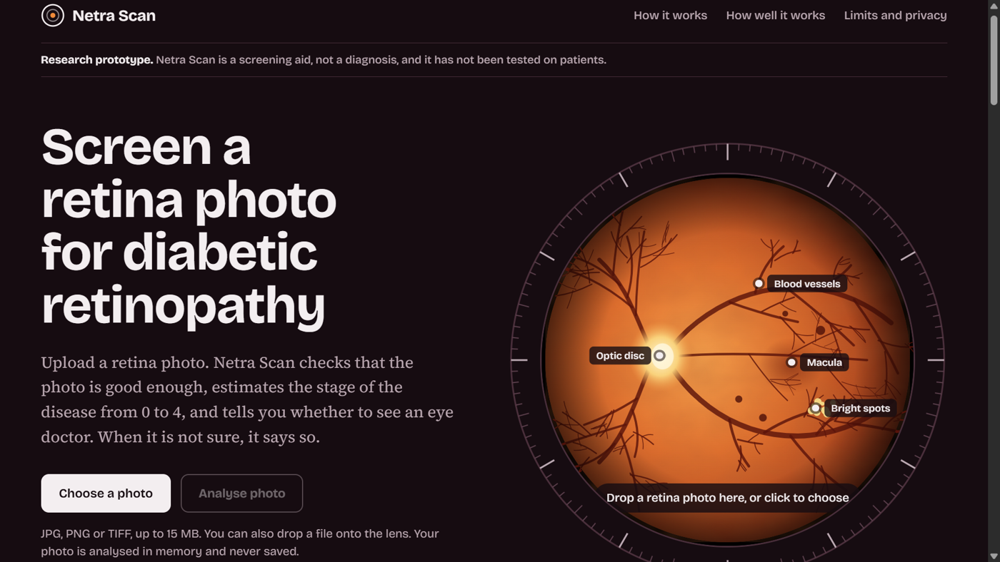
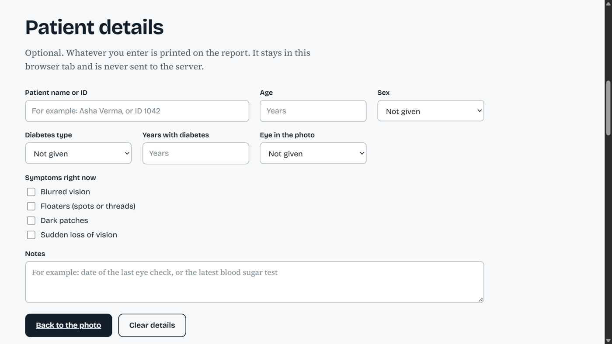
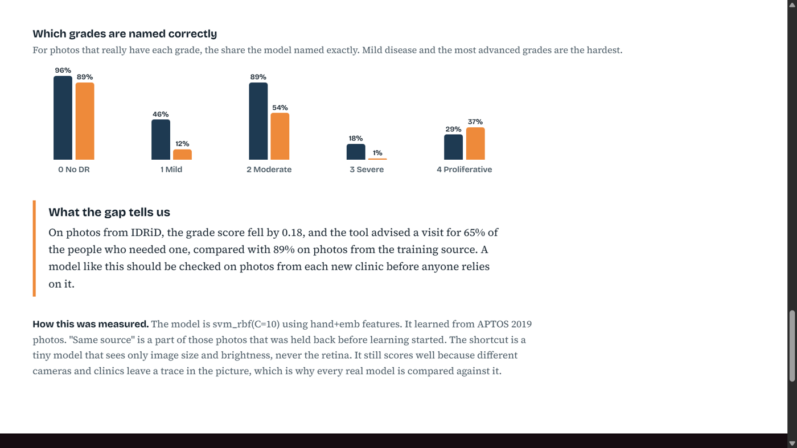
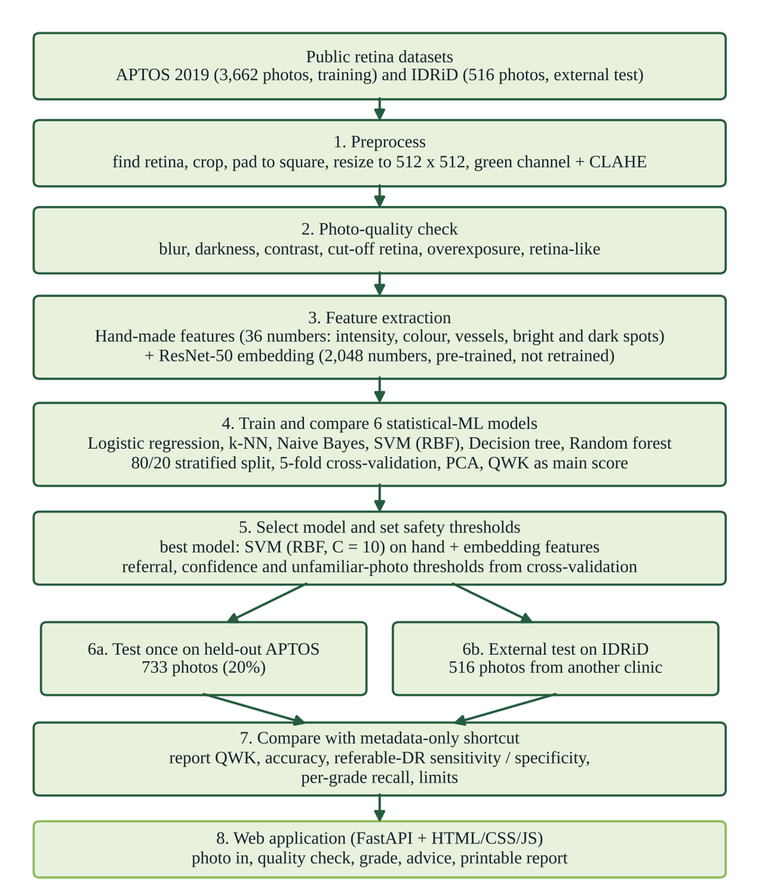
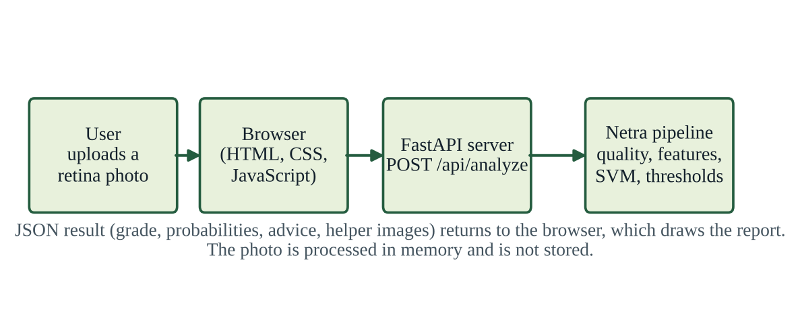
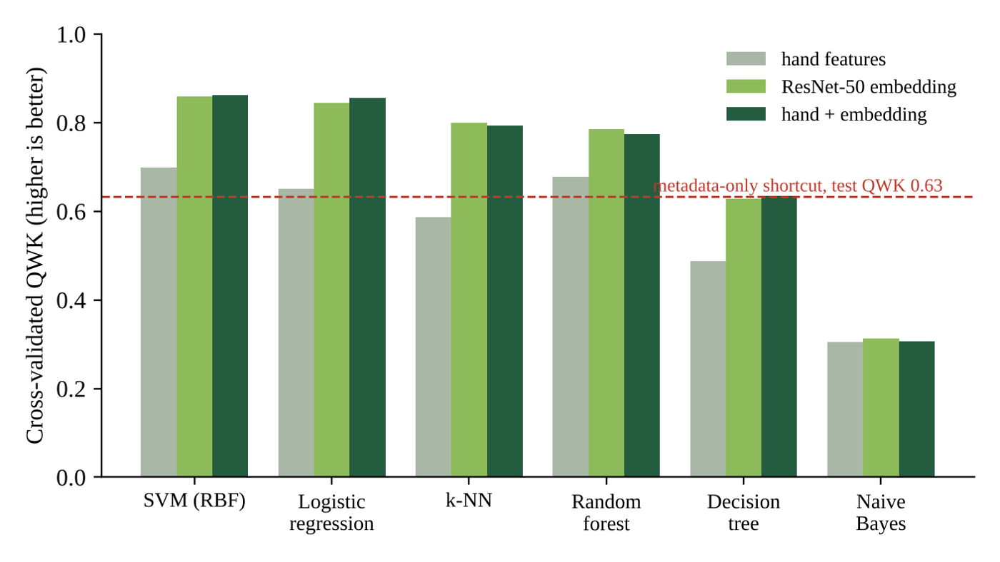
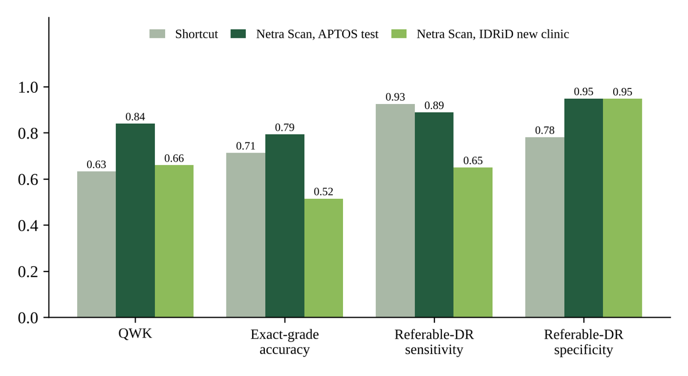
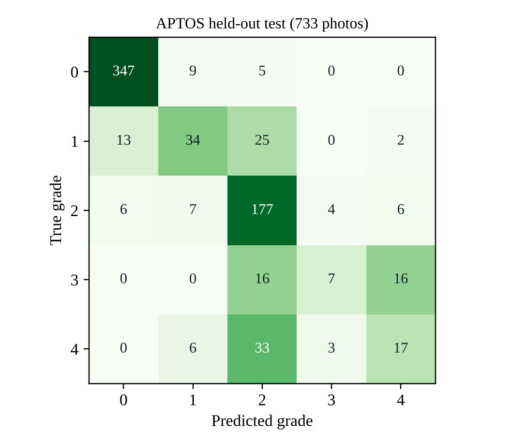
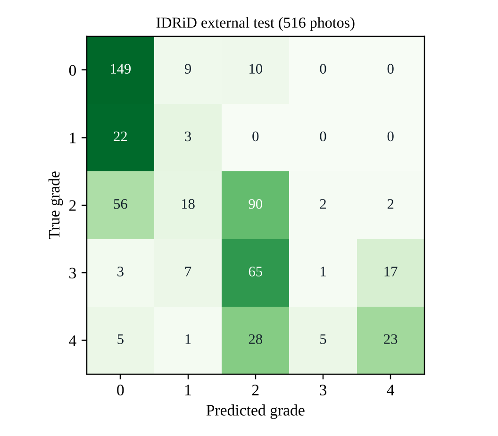
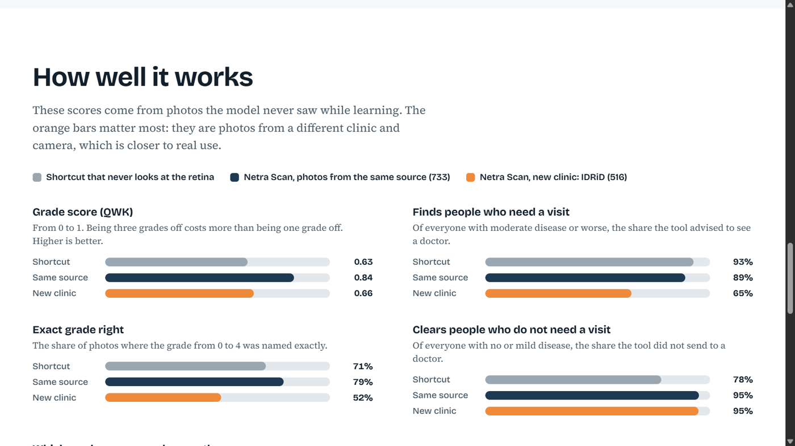

# Netra Scan

**Early detection of diabetic retinopathy from retina photos.**
Upload a retina (fundus) photo and Netra Scan checks the photo quality, estimates the stage of the disease from 0 to 4, and says whether an eye-doctor visit is advisable. When it is not sure, it says so.



> **Research prototype.** Netra Scan is a screening aid, not a diagnosis, and it has not been tested on patients. Medical use would need clinical validation and regulatory approval.

Student project for the course Statistical Machine Learning, by **Sneha** (Enrollment No: S25CSEU1212).

---

## What it does

1. **Checks the photo** (blur, too dark, flat, retina cut off, not a retina).
2. **Estimates the DR grade 0 to 4** (0 no DR, 1 mild, 2 moderate, 3 severe, 4 proliferative) with a confidence value.
3. **Advises a visit** to an eye doctor when the grade is 2 or worse ("referable").
4. **Says "uncertain"** when the model is unsure or the photo looks unlike its training photos.
5. Shows helper pictures (contrast-enhanced view, blood-vessel map) and a **printable report**.
6. The photo is analysed in memory and **never saved**.

| Patient details | How well it works |
|---|---|
|  |  |

## How it works

```
photo -> find retina, crop, square, 512x512 -> quality check -> features -> model -> result
                                                               |
                  36 hand-made measurements (vessels, bright and dark spots, colours)
                  + 2048-number embedding from a frozen, pre-trained ResNet-50
```

- The learning is done by **classical statistical-ML models**: logistic regression, k-NN, naive Bayes, SVM, decision tree and random forest, with scaling and PCA. The ResNet-50 is only a fixed "photo reader" and is not trained here.
- **Best model:** SVM with an RBF kernel (C = 10) on hand features plus embedding.
- Thresholds (referral 0.61, confidence 0.58, unfamiliar-photo distance 57.1) are chosen on training data only.



**Website:** FastAPI backend (`/api/health`, `/api/model-info`, `/api/analyze`) and a plain HTML, CSS and JavaScript frontend. Docker files are included.



## Results

Data: **APTOS 2019** (3,662 graded photos; 2,929 for training and 733 held out as a test set, seed 42) and **IDRiD** (516 photos from a different clinic, used only as an outside test).

| Test | Photos | Accuracy | QWK | Referable sensitivity | Referable specificity | Referable AUC |
|---|---|---|---|---|---|---|
| Cross-validation (training data) | 2,929 | 0.806 | 0.863 | 0.901 | 0.938 | 0.976 |
| APTOS held-out test | 733 | 0.794 | 0.840 | 0.889 | 0.949 | 0.978 |
| IDRiD, a new clinic | 516 | 0.516 | 0.660 | 0.650 | 0.948 | 0.915 |
| Shortcut (image size and brightness only) | 733 | 0.714 | 0.633 | 0.926 | 0.782 | 0.931 |

QWK is quadratic weighted kappa, a score of agreement with the doctors' grades where 1 is perfect. "Referable" means grade 2 or worse.




**Honest findings**

- A model that only sees image size and brightness (no retina content) already reaches 71% accuracy on APTOS, because different cameras at different clinics leave a trace in the picture. Every model is compared against this shortcut.
- On a new clinic (IDRiD) the scores fall: QWK 0.84 to 0.66, and the share of referable cases caught falls from 89% to 65%. The website says this on its "How well it works" and "Limits and privacy" sections.
- Mild (grade 1) and severe or proliferative (grades 3 and 4) are the hardest grades to separate.

| APTOS test | IDRiD (new clinic) |
|---|---|
|  |  |



## Datasets

- APTOS 2019 Blindness Detection: https://www.kaggle.com/c/aptos2019-blindness-detection
- IDRiD (Indian Diabetic Retinopathy Image Dataset): https://idrid.grand-challenge.org
- A comparison of seven public datasets we looked at is in [`docs/dataset_comparison.md`](docs/dataset_comparison.md).

The photos are not stored in this repository (size and licence). Download them from the links above and place them as shown below.

## Folder map

| Path | What is inside |
|---|---|
| `netra/` | the code: preprocessing, quality check, features, embeddings, metrics, prediction |
| `scripts/` | the steps you run: `00` check setup, `01` extract features, `02` train and compare, `03` external test |
| `app/` | the website: `main.py` (FastAPI backend) and `static/` (HTML, CSS, JavaScript) |
| `models/` | the trained model and its numbers |
| `reports/` | comparison tables and charts |
| `docs/` | dataset comparison and screenshots |
| `tests/` | `test_app.py` checks the backend |
| `Dockerfile`, `deploy/` | for putting the site online |

## Run it yourself (Windows, PowerShell, VS Code)

```
python -m venv .venv
.venv\Scripts\Activate.ps1
pip install -r requirements.txt
python scripts/00_check_setup.py
python -m uvicorn app.main:app
```

Open http://127.0.0.1:8000 in your browser and upload a retina photo.

If PowerShell says "running scripts is disabled", run `Set-ExecutionPolicy -Scope CurrentUser RemoteSigned`, answer `Y`, and activate again.

### Train it again from the data

```
data/aptos/processed/<photo_id>.png      512x512 photos
data/aptos/train_with_stats.csv          columns id_code, diagnosis, width, height, ...
data/idrid/images/IDRiD_001.jpg ...      IDRiD "disease grading" photos
data/idrid/labels.csv                    IDRiD grading labels
```

```
python scripts/01_extract_features.py --name aptos --images data/aptos/processed --labels data/aptos/train_with_stats.csv
python scripts/02_train_models.py
python scripts/01_extract_features.py --name idrid --images data/idrid/images --labels data/idrid/labels.csv
python scripts/03_external_validation.py
```

Add `--size 256` to both step-01 commands for a faster run that is a bit less accurate.

### Tests

```
python tests/test_app.py
```

## Honest limits

- Trained on one public dataset; other cameras and clinics usually give lower scores (measured on IDRiD above).
- The quality-check thresholds come from APTOS photos only.
- The helper pictures are image filters, not an explanation of the model's decision.
- The ResNet-50 makes the site too heavy for free hosting, so it runs on a laptop CPU and is shown through a temporary public link in the demo.
- Not clinically validated, not a medical device.

## Future scope

- Train on more varied data such as EyePACS and Messidor-2.
- Tune grade cut-offs, average the best models, add confidence intervals.
- A lighter model so the site can be hosted for free.
- Test with eye doctors before any real-world use.
